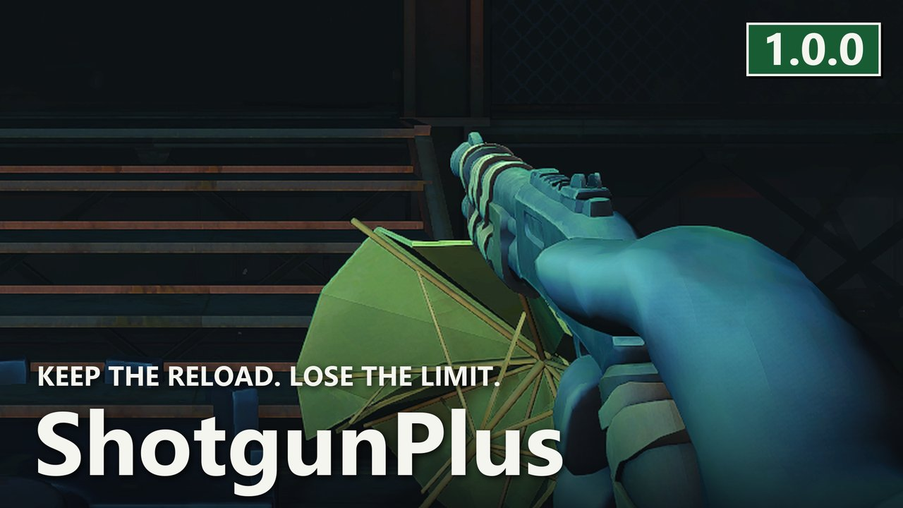
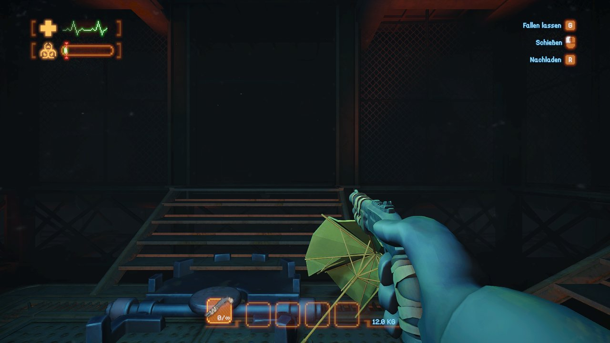

# ShotgunPlus

Infinite reserve with the normal one-round reload. Select an infinite magazine when you want to shoot without reloading.

> 🛟 **Need help or found a bug?** Get support at [support.doodesch.de/shotgunplus](https://support.doodesch.de/shotgunplus).



For MIMESIS and MelonLoader 0.7.3. A separate mod for the **Shotgun** (item 1000). Install any combination of the six weapon mods. No MimicAPI or separate weapon-core DLL is required.

## Install

1. In Steam, open MIMESIS > Manage > Browse local files.
2. Install MelonLoader 0.7.3 for the game.
3. Copy `ShotgunPlus.dll` into `Mods` beside `MIMESIS.exe`.
4. Start the game once to create `UserData/MelonPreferences.cfg`.
5. Set your options in `[ShotgunPlus]`, then restart the game. Settings changed through a live preferences editor apply to the next attack.

```text
MIMESIS/
  MIMESIS.exe
  Mods/
    ShotgunPlus.dll
  UserData/
    MelonPreferences.cfg
```

## Multiplayer

Gameplay settings follow the lobby host. Each host controls only the weapon mods they have installed. If the host does not have this mod, clients use native gameplay. Client preferences stay saved for their own lobbies. `ShowInfinity` remains local.

All settings in this mod are safe to update live. Damage, reach, cooldown and reload changes apply to the next action; they do not replace an action that is already running. Use the same mod versions on host and clients for the matching HUD and input behavior.

## Configuration

Optional tuning starts at **1.0 = native**. The primary unlimited mode is enabled by default as described above. Invalid values fall back to the native behavior recorded by the host-settings layer.

| Setting | Default | Effect |
| --- | --- | --- |
| `Enabled` | `true` | Enable gameplay changes for this weapon |
| `AmmoMode` | `1` | 0 = native, 1 = infinite reserve with normal reload, 2 = infinite magazine, 3 = no reload with finite ammo |
| `Unbreakable` | `false` | Prevent combat durability loss |
| `SpreadMultiplier` | `1.0` | Native hit-cone angle multiplier, 0.1-4 |
| `ReloadTimeMultiplier` | `1.0` | Reload animation, insertion event and reload cooldown duration multiplier, 0.25-4 |
| `DamageMultiplier` | `1.0` | Attack damage multiplier, 0-10; Amped Smash and crowbar throws use their separate settings |
| `RangeMultiplier` | `1.0` | Attack reach multiplier, 0.25-4 |
| `CooldownMultiplier` | `1.0` | Attack skill cooldown multiplier, 0.1-5; animation duration stays native |
| `ShowInfinity` | `true` | Local HUD only: show infinity for unlimited ammunition, energy or protected bat durability |

The native ammo label shows loaded rounds plus infinity in reserve mode, for example `1/∞` or `2/∞`. Infinite-magazine mode shows `∞`. Mode 3 shows the remaining loaded rounds plus compatible inventory shells as ∞/N. Each shot spends real ammo and shooting stops at zero. Reload and firing inputs stay native. `SpreadMultiplier` changes the actual hit-cone width.

## In game



The native Shotgun with infinite reserve and normal reloading.

## Build

Build with .NET SDK 8 and the shared Mimesis workspace reference set. The project uses the same shared build, deployment guards and host-settings source as the other Mimesis mods. Shared helpers are compiled into this DLL.
